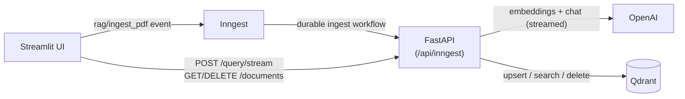

# RAG Production App

A Retrieval-Augmented Generation (RAG) app for PDFs. Upload one or more documents, ask questions in plain language, and get **streamed** answers that cite the document and page they came from. Embeddings and answers come from OpenAI; vectors live in Qdrant.

Ingestion runs as a **durable, retryable workflow** on [Inngest](https://www.inngest.com/), so every step is observable and failures can be retried instead of silently lost.

<!-- TODO: add a demo GIF or screenshot here, e.g.  -->

## Features

- **One-command startup**: `docker compose up --build` runs Qdrant, Inngest, the FastAPI backend and the Streamlit UI.
- **Streaming answers**: tokens appear in the UI as OpenAI generates them (`POST /query/stream`).
- **Multi-file upload** and a **document list with delete** (full create / read / delete from the UI and the API).
- **PDF ingestion pipeline**: load, chunk (with overlap), embed in batches, upsert into Qdrant.
- **Page-level citations**: every chunk keeps its source file and page number, and answers cite their sources.
- **Idempotent re-ingestion**: chunk IDs are deterministic (`uuid5(source:index)`) and stale chunks are deleted when a document is re-uploaded.
- **Relevance threshold**: low-similarity chunks are filtered out, and the app says so instead of guessing when nothing relevant is found.
- **Grounded answers**: the model answers only from the retrieved context, cites passages like `[1]`, and says "I don't know" otherwise.
- **Rate limiting** (per client IP, via slowapi) and a `/health` endpoint.
- **Embedding-model guard**: if a Qdrant collection was built with a different vector size, the app fails with a clear message instead of a cryptic error.

## Architecture



**Why queries bypass Inngest.** Inngest serializes each step's result; there is no channel to stream tokens through it. Ingestion (slow, failure-prone, worth retrying) stays on Inngest. Interactive queries go straight to FastAPI so the answer can stream. The original durable query workflow (`rag/query_pdf_ai`) is still registered if you want to trigger it by event.

**Ingest flow** (`rag/ingest_pdf`)

1. `load-and-chunk`: read the PDF page by page (LlamaIndex `PDFReader`) and split with `SentenceSplitter`, keeping the page number for each chunk.
2. `embed-and-upsert`: embed chunks in batches, delete any old chunks for that file, then upsert the new ones into Qdrant.

**Query flow** (`/query` and `/query/stream`)

1. Embed the question and run a cosine search in Qdrant with a score threshold (optionally filtered to one document).
2. Build a numbered, source-labelled context block and ask the LLM to answer from it with citations. Sources are sent up front in the `X-Sources` response header; the answer body streams.

## Tech stack

| Layer | Tool |
|---|---|
| Language / packaging | Python 3.13, [uv](https://docs.astral.sh/uv/) |
| Workflow engine | [Inngest](https://www.inngest.com/) (Python SDK + dev server) |
| API | FastAPI + Uvicorn, slowapi (rate limiting) |
| PDF parsing and chunking | LlamaIndex (`PDFReader`, `SentenceSplitter`) |
| Vector database | [Qdrant](https://qdrant.tech/) |
| Embeddings | `text-embedding-3-small` (OpenAI) |
| LLM | `gpt-4o-mini` (OpenAI, configurable) |
| UI | Streamlit |

## Quick start (Docker)

You need [Docker](https://docs.docker.com/get-docker/) and an [OpenAI API key](https://platform.openai.com/api-keys).

```bash
git clone https://github.com/kisinja/rag-production-app.git
cd rag-production-app
cp .env.example .env        # then put your key in .env: OPENAI_API_KEY=sk-...
docker compose up --build
```

| Service | URL |
|---|---|
| Streamlit UI | <http://localhost:8501> |
| API docs (Swagger) | <http://localhost:8000/docs> |
| Inngest dashboard | <http://localhost:8288> |
| Qdrant dashboard | <http://localhost:6333/dashboard> |

Upload a PDF, wait a few seconds for indexing (hit **Refresh** to see it appear in the list), and ask a question. Check <http://localhost:8288/apps> to see the app **Synced** with two functions.

Data persists in Docker volumes (`qdrant_storage`, `uploads`). `docker compose down -v` wipes them.

## Running without Docker

Prerequisites: Python 3.13, [uv](https://docs.astral.sh/uv/getting-started/installation/), Node.js (for the Inngest dev server via `npx`), and Docker (for Qdrant only).

```bash
uv sync
cp .env.example .env        # add OPENAI_API_KEY

# 1. Qdrant
docker run -p 6333:6333 -v "$(pwd)/qdrant_storage:/qdrant/storage" qdrant/qdrant
# 2. Backend API
uv run uvicorn rag_production_app.main:app --reload --port 8000
# 3. Inngest dev server
npx inngest-cli dev -u http://127.0.0.1:8000/api/inngest --no-discovery
# 4. Streamlit UI
uv run streamlit run src/rag_production_app/streamlit_app.py
```

## API

| Method | Path | Description |
|---|---|---|
| `GET` | `/health` | Liveness check: `{"status": "ok"}` |
| `POST` | `/query` | Non-streaming answer as JSON: `{answer, sources, num_contexts}` |
| `POST` | `/query/stream` | Streams the answer as plain text; sources in the `X-Sources` header (JSON array) |
| `GET` | `/documents` | List ingested documents with chunk counts |
| `DELETE` | `/documents/{source}` | Delete a document's chunks and its uploaded file |

Query body: `{"question": "...", "top_k": 5, "source": "optional-file.pdf"}`.

```bash
curl -N -X POST localhost:8000/query/stream \
  -H 'content-type: application/json' \
  -d '{"question": "What is this document about?"}'
```

`/query`, `/query/stream`, `/documents` are rate limited per client IP (defaults: 10/min for queries, 60/min for documents). Exceeding the limit returns `429`. Inside Docker Compose all UI traffic arrives from the Streamlit container, so it shares one bucket; raise the limits in `.env` if several people use the UI at once.

## Configuration

All settings are defined in `src/rag_production_app/config.py` and can be overridden in `.env`.

| Variable | Default | Purpose |
|---|---|---|
| `OPENAI_API_KEY` | (required) | Your OpenAI key. Keep it in `.env`, never commit it |
| `OPENAI_BASE_URL` | `https://api.openai.com/v1` | Any OpenAI-compatible endpoint |
| `LLM_MODEL` | `gpt-4o-mini` | Model used to write answers |
| `EMBED_MODEL` | `text-embedding-3-small` | Embedding model |
| `EMBED_DIM` | `1536` | Embedding size (must match the model) |
| `QDRANT_URL` | `http://localhost:6333` | Qdrant server (compose sets it for you) |
| `QDRANT_COLLECTION` | `docs` | Collection name |
| `CHUNK_SIZE` / `CHUNK_OVERLAP` | `1000` / `100` | Chunking, in tokens |
| `EMBED_BATCH_SIZE` | `32` | Chunks per embedding request |
| `MIN_SCORE` | `0.2` | Minimum cosine similarity for a chunk to be used. Re-tune with `eval/run_eval.py` |
| `RATE_LIMIT_QUERY` | `10/minute` | Per-IP limit for `/query*` |
| `RATE_LIMIT_DOCUMENTS` | `60/minute` | Per-IP limit for `/documents*` |
| `UPLOADS_DIR` | `uploads` | Where the UI saves PDFs and the API reads/deletes them |
| `API_URL` / `INNGEST_URL` | `http://127.0.0.1:8000` / `http://127.0.0.1:8288` | Where the UI finds the API and Inngest |

**Changing the embedding model:** vectors from different models are not comparable and have different sizes. Set a new `QDRANT_COLLECTION` (or delete the old one) and re-ingest your PDFs. The app refuses to start against a collection with a mismatched size and tells you so.

## Project structure

```
src/rag_production_app/
├── config.py          # Settings (env-overridable)
├── custom_types.py    # Pydantic models for chunks, hits and step outputs
├── data_loader.py     # PDF loading, chunking, batched async embeddings
├── vector_db.py       # Qdrant wrapper: upsert, search, list/count/delete by source
├── rag.py             # Retrieval, prompt building, answer + token streaming
├── main.py            # FastAPI endpoints + Inngest ingest/query functions
└── streamlit_app.py   # Upload, document list, streaming Q&A UI
Dockerfile             # One image for API and UI
docker-compose.yml     # Qdrant + Inngest + API + Streamlit
eval/                  # Retrieval evaluation harness (hit rate, MRR)
```

## Testing

```bash
uv run pytest -q
```

The unit tests mock OpenAI and Qdrant, so they need no network or API key. For an end-to-end check, run `docker compose up --build`, then:

1. Upload one or more PDFs and confirm the ingest runs finish in the Inngest dashboard.
2. Ask a question the PDF answers: the answer should stream in with sources like `file.pdf, p.3`.
3. Ask something unrelated: you should get "I don't know" or a "nothing relevant found" message.
4. Upload the same PDF again: the chunk count in the document list should not grow.
5. Delete a document with 🗑️ and confirm it disappears from the list and from answers.

## Troubleshooting

**Inngest shows `url_not_found` / the app is "Not Synced".** Without Docker, the sync URL must be exactly `http://127.0.0.1:8000/api/inngest` (it ends in `inngest`, not `ingest`). Remove the bad app from the dashboard or restart the dev server with the command above.

**`Attribute "app" not found in module`.** Run Uvicorn from the project root with the full module path: `uvicorn rag_production_app.main:app`.

**`Qdrant collection 'docs' has 768-dim vectors but EMBED_DIM=1536`.** The collection was created by an earlier embedding model (for example Ollama's `nomic-embed-text`). Delete it (`curl -X DELETE localhost:6333/collections/docs`) or set a new `QDRANT_COLLECTION`, then re-ingest.

**A freshly uploaded PDF is missing from the list.** Indexing is asynchronous. Hit Refresh, and check the run in the Inngest dashboard if it never shows up (for example a scanned PDF with no text layer).

**`401 Incorrect API key` / answers fail immediately.** `OPENAI_API_KEY` is missing or wrong in `.env`. After editing `.env`, run `docker compose up -d --force-recreate api`.

**`PermissionError: ... multiply-linked file` from nltk when running tests.** uv hard-linked the packages from its cache. Run `UV_LINK_MODE=copy uv sync --reinstall`.

## Known limitations and roadmap

- PDFs only; scanned (image-only) PDFs need OCR, which is not included.
- Uploaded files are passed to the backend by path, so the UI and backend must share a filesystem (a Docker volume here). Moving to object storage is the next step for a real deployment.
- Dense (vector) search only. Hybrid search (dense plus BM25) and reranking are planned.
- No authentication. Rate limiting is per IP only, and in-memory (per API process).
- The Inngest dev server is used for local development; production would use Inngest Cloud or a self-hosted server with signing keys.
# pdf-chat-rag

# pdf-chat-rag

# pdf-rag-assistant

